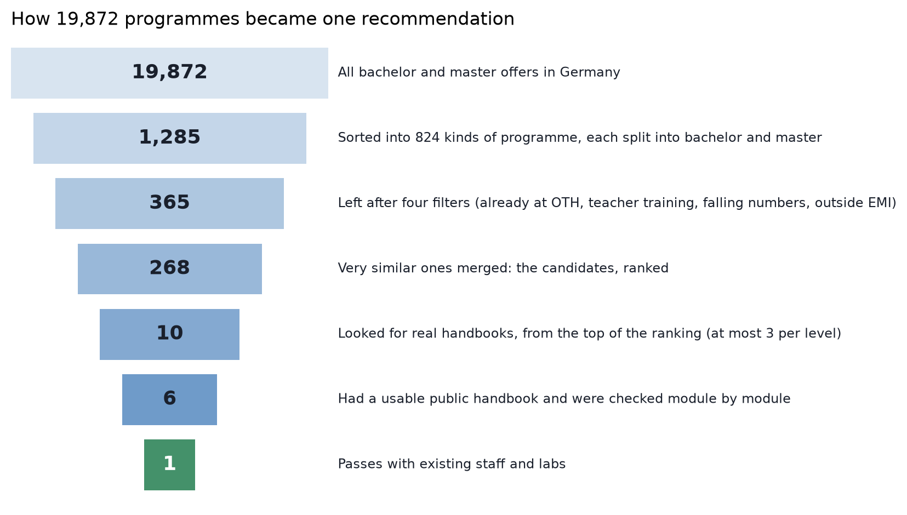

# In one page

**The question.** The faculty EMI at OTH Amberg-Weiden (electrical engineering, media and computer science) wants
to know which **new** degree programme it should start. The new programme should bring students who would otherwise
not come to OTH, and the faculty must be able to teach it with the **professors and labs it already has**.

**What we did.** We did not start from our own favourite ideas. We took **every** bachelor and master programme
offered in Germany (19,872 offers), sorted them into kinds of programme, removed the kinds that do not fit, and
measured the rest: Are there students? Are there jobs? How many students would come to Amberg or Weiden? Then we
checked the best-ranked ones against real course plans: can EMI teach it?

**What we found.** We could check **6 candidates** in depth. **One of them passes**: a **general computer science
(Informatik) bachelor**.

- EMI already teaches about **half to two thirds** of what such a programme contains (49 % to 68 %, depending on how
  doubtful modules are read).
- About **18 to 20 first-year students a year** would be new to OTH (a rough estimate with a wide range).
- It needs at least about **52 credits of new teaching**, almost all of it written and taught by EMI's current
  lecturers. That is roughly the yearly teaching of **at least 1.2 professors**. **No new lab** is needed.

**How sure are we.** The answer holds under the rules **our team** set while reading the supervisor's conditions.
The supervisor has **not yet confirmed** those rules, and under some stricter readings no candidate passes at all
(part 4). Many strong-looking candidates further down the list were never checked. We say all of this openly.

**This is a preliminary result.** An independent re-check (part 6) found the arithmetic correct, but also that the
module judgements were not made to one consistent standard, and that several deciding rules were set after earlier
results were known. What is established: an Informatik bachelor fits the 40-80 % band. What is not: that it is the
only programme EMI can run, that it attracts the most students, and the exact number of students new to OTH. A
corrected rerun is planned.

{ width=100% }

# 1. Words you will meet

| Word | Meaning in plain words |
|--------|------------------------------|
| **Programme** | A degree course, for example "Informatik, Bachelor". |
| **Module** | One course inside a programme, for example "Databases". A programme has a few dozen modules. |
| **Credits (ECTS)** | A measure of study work. One semester is 30 credits; a typical module is 5 credits. A bachelor here has 210 credits. |
| **Module handbook** | The official document of a university that describes every module of a programme. |
| **First-years** | Students who start a programme in a given year. |
| **New to OTH** | First-years who would not otherwise study at OTH (not taken away from OTH's existing programmes). |
| **Professor-equivalent** | The yearly teaching of one professor. "1.2 professor-equivalents" means the extra teaching equals the normal load of about one and a fifth professors. |
| **Existing resources** | The professors, lecturers and labs EMI has today: no new professorship, no new lab. |
| **Overlap** | The share of a new programme that EMI already teaches in its current modules. |
| **AI reader** | An AI model that read texts and made a judgement following written rules. It can be wrong, and because the same model did all the reading, it can be wrong in the same way each time. |

# 2. Why we started again

Our first analysis (in October) started from ideas we had ourselves: cybersecurity and robotics. That is a weak
start, because the answer can then only be one of our own guesses. After the supervisor made "existing staff and
labs only" a firm condition, we started again and let the data choose the candidates. A first automatic attempt had
mistakes and was thrown away. Everything in this document is the second, checked run.

**The supervisor's conditions** (from the meeting and his email):

- A whole new degree programme, not just extra modules. It must not exist at OTH already.
- Bachelor or master. Full-time. For German and international students.
- It must fit the faculty EMI.
- It must be possible with **existing** staff and labs.
- His measure: **40 % to 80 %** of the new programme should overlap with lectures EMI already gives. Less than 40 %
  would cost too many new resources; more than 80 % would just be a renamed existing programme. **Our reading**
  (not yet confirmed by him): the 40 % applies to all of EMI's lectures together, the 80 % to the share taken from
  any **one** existing programme.
- Success means students who are **new** to OTH.

# 3. The steps, one by one

## Step 0: Write the rules first

Before looking at any result, we wrote down every rule and every threshold in a file
(`configs/funnel.yaml`). This is like a teacher writing the marking scheme before reading the exams: it stops us
from bending the rules to get an answer we like. When a rule had to change later, we wrote down when, why and who
decided it (`docs/decision_log.md`). Some rules were changed after we had seen results; we say where.

## Step 1: Check the data

We checked that all the data we need is there and up to date:

- **The national programme catalogue** (the data behind "Hochschulkompass"): 19,872 bachelor and master offers from
  404 institutions (9,703 bachelor, 10,169 master).
- **Official student numbers** from the Federal Statistical Office (Destatis): first-years and graduates by subject,
  for Bavaria and all of Germany.
- **EMI's own module handbooks** (what EMI teaches today).
- **EMI's timetables**, which the supervisor gave us. They stay private and are never published; lecturers appear
  only as codes, never by name.

## Step 2: Sort all programmes into kinds

Many programmes are the same thing under different names ("Informatik", "Computer Science", "Angewandte
Informatik"). A computer model turned the title and focus areas of every full-time programme into numbers, so that
programmes with similar content end up close together, like sorting a pile of books by topic. Then it formed groups.

- **Result: 824 kinds of programme.**
  - 233 groups come back reliably when the sorting is repeated.
  - 130 are mid-sized groups. We kept them, so that common programmes (such as Informatik or electrical
    engineering) are not lost.
  - 461 are small, rare groups. We kept them, because rare programmes are welcome (the supervisor's example was
    Motorsport Engineering).
- **A weakness:** when readers checked samples, too many groups mixed different things (22 of 30 were clean; our own
  bar was 24). About a third of the groups that reach the later steps are marked "mixed".

## Step 3: Remove what does not fit

Each kind can exist as a bachelor and as a master. That gives **1,285** "kind and level" combinations. Four
filters removed what does not fit:

| Filter | Removed |
|---|---|
| OTH already offers it | 44 |
| It is teacher training (a state exam that a faculty cannot open alone) | 244 |
| Student numbers in the subject are clearly falling | 17 |
| It is outside EMI's field (for example medicine or law) | 859 |

Some were removed for several reasons. **365 combinations were left.** Very similar ones were merged, which gave
**268 candidates**.

- **The EMI filter is generous on purpose.** It keeps borderline cases so that nothing good is lost early. As a
  result, about half of what is left is not really EMI's subject (for example urban planning or civil engineering).
  The real test of fit comes in Step 7.
- **Competition.** We counted how many similar programmes exist nearby. Our check of what counts as "similar" did
  not pass its own test, so we treat these counts as rough.

## Step 4: Are students coming?

We looked at how many German students started (bachelor, 2019 to 2024) or finished (master, 2019 to 2025) in each
subject in Bavaria.

- 128 of the 365 combinations are in subjects with **growing** numbers; 229 are in subjects with **falling**
  numbers; 8 have no usable trend.
- The typical subject loses about **2 % of German students a year**. Foreign students grow by about **9 % a year**.

Forecasting is hard here. When we tested forecasting methods on past years, the most reliable one **on average** was
simply "next year is like this year". So we use the latest numbers for the size, and the past trend only as one part
of the score.

## Step 5: Are there jobs nearby?

We asked the job board of the Federal Employment Agency how many job ads mention words from each candidate's
programme titles, within 100 km of Amberg, in Bavaria and in Germany (all on 15 Nov 2026).

- The typical combination has about **22 ads within 100 km**, but the spread is huge (a quarter have 2 or fewer, a
  quarter more than 116).
- This only counts how often a word appears in job ads, not how many jobs wait for graduates. It is a rough signal.
- **We caught an error:** the job board read "Amberg" as a village of the same name near Buchloe in Swabia, about
  177 km away. We now send "Amberg, Oberpfalz" and check the place in every answer.

## Step 6: How many first-year students would come?

This works in two parts.

1. **Starting value.** How many German first-years does a programme of this subject get in Bavaria on average?
   (First-years of the subject divided by the number of such programmes in Bavaria.)
2. **Distance adjustment.** A standard "gravity" model (often called a Huff model) adjusts that value up or down.
   Its idea: school leavers are more likely to choose a programme close to home. It compares Amberg and Weiden with
   where the similar programmes are, using the school leavers of every Bavarian county.

- A typical combination would get about **24 first-years a year**; according to the model about **16 to 17** of them
  would be **new to OTH**, the rest would have come to OTH anyway.
- 140 of the 365 combinations stay below **20 first-years**, the minimum we assumed for a programme to run.
- These are rough sizes, not forecasts. The range goes from a third to three times the middle value. We could
  compare the method with real intake figures for only one subject, and there it was off by about a factor of 3.
- "New to OTH" uses OTH's nearest existing programme as a stand-in; for most candidates it is not really similar.

## Step 7: Can EMI really teach it?

This is the most important test, because of the supervisor's condition.

1. **Ranking.** We ranked the 268 candidates by everything known so far and went down the list.
2. **Stopping rule (fixed in advance).** We check at most **3 bachelors and 3 masters**. Once 3 bachelors were
   checked, the next bachelors on the list were **skipped**, including plain Informatik, electrical engineering,
   data science and software engineering. They were never tested.
3. **Real handbooks.** For each candidate we looked for the official, public module handbooks of real programmes of
   that kind at other universities of applied sciences. We only took what websites allow automated tools to fetch.
   Four candidates (all masters) had no usable public handbook.
4. **Module by module.** Every module of these handbooks was placed next to EMI's most similar modules. AI readers
   then decided, following written rules, whether EMI already teaches it (unchanged, or with up to a third
   rewritten), whether a current lecturer could write it, whether it is new to EMI, or whether it needs a lab EMI
   does not have.
5. **Cross-checks.** The readers were not told which programme or university a module came from. A second reader
   checked a sample without seeing the first answers, and a third reader settled every disagreement. All readers
   were the same AI model, so these checks are not fully independent.

**We did this three times**, because each review found a weakness:

- At first, the readers saw too few of EMI's modules, so some real matches were missed.
- Then, readers treated credits differently: one counted a 5-credit EMI module as covering an 8-credit module,
  another said two 5-credit EMI modules could not cover a 10-credit module.
- Our team decided: **content counts, not credits**, and **two EMI modules may together cover one module**, because
  EMI teaches in 5-credit modules. **This rule was set after we had seen the second result, and it decides the
  outcome:** without it, no candidate passes.

**Result of the test** (6 candidates checked, 10 handbooks):

| Candidate | How much EMI already teaches | Verdict |
|---|---|---|
| Computer science, bachelor | 68 % | passes with existing staff and labs |
| Cybersecurity, bachelor | 63 % and 58 % | in the range, but needs more outside teaching than allowed (forensics, IT law, auditing) |
| Computer science, master | 35 % and 52 % | depends on which handbook is used |
| Urban planning, bachelor | 14 % | fails |
| Civil engineering, master | 5 % and 1 % | fails, and needs labs |
| Architecture, master | 0 % and 4 % | fails |

**A correction we made.** One candidate (a communication and media master) should never have been checked, because
it expected fewer than 20 first-years. We removed it and checked the next valid candidate in line (architecture).

## Step 8: Which one, and how sure?

1. **Only within the scope.** Only a candidate that EMI can run with existing staff and labs may be recommended.
   Of the 6 checked, that is **only computer science**. So there was nothing to rank it against: under the rules it
   is recommended if enough students are expected (at least 15 new to OTH).
2. **For information: computer science against cybersecurity.** Cybersecurity is in the range but needs outside
   teaching, so it is shown for information only. We scored both from 1 to 5 on six criteria with the weights agreed
   earlier in the project (student demand 30 %, jobs 20 %, fit 20 %, feasibility 15 %, competition 10 %, region 5 %).
   Because every input is uncertain, we drew **10,000 random versions** of the inputs and the weights (a "Monte
   Carlo" simulation). Computer science came first in 82 % of them. With more uncertainty the share drops to about
   77 %; measured as one of the large Informatik groups, cybersecurity comes first, and as the other the lead is
   much smaller. So this comparison is close.
3. **Stress test.** We changed 20 rules that we had fixed in advance (for example a stricter minimum class size, or a
   cap on new teaching) in every possible combination, about **18 million**, and recorded the answer for each.

**The answer:** start a **general computer science (Informatik) bachelor**.

| What | Value |
|------------|--------------------|
| EMI already teaches | about 68 % of the taught part (thesis and internship not counted) |
| New teaching needed | at least 52.5 credits: 50.5 as new modules by current lecturers, 2 by a hired lecturer |
| Extra teaching load | at least about 1.2 professors' teaching a year (a minimum: rewriting covered modules and extra groups come on top) |
| New lab needed | no |
| First-years new to OTH | about 18 to 20 a year as a general Informatik programme; the model gives 26 for the small "Computer Science" group, which is less reliable |
| Minimum class size | passes 20; measured as Informatik it would fail if 25 were required |

**A second handbook supports it.** The test above rests on one handbook (OTH Regensburg's International Computer
Science), because the only other similar programme's handbook could not be fetched. So we also checked a plain
Informatik bachelor (TH Ingolstadt) in the same way, with the same AI readers. It gives almost the same picture: about
67 % already taught, 55 credits of new teaching, about 1.2 professors' teaching, no new lab. It also depends on the
two-module rule (32 % without it).

# 4. How firm is the answer?

**It holds:**

- under the rules our team set (reading the supervisor's 40-80 % measure);
- when we count the least-covered optional modules (61 %), or count doubtful modules as not covered (57 %);
- when a reviewer corrected the doubtful modules, including language courses (49 %, still above 40 %);
- when we measure it as the large "Informatik" groups instead of the small "Computer Science" group.

**It breaks (no candidate passes at all):**

- if new modules by current lecturers were capped at 10 or 20 credits (it needs about 50);
- if at most 50 % of the new programme may come from one existing programme (here 57 % would come from
  Medieninformatik);
- if two EMI modules may **not** be counted together for one module;
- if the minimum class size were 25 instead of 20 (measured as Informatik);
- under the project's old, stricter rule (80 % already taught, at most 20 % new).

**About the 18 million combinations.** In 78 % of them no candidate passes. This is **not** a probability: it comes
entirely from two of the 20 rules (the cap on new modules and the 50 % limit). In every combination without those two
caps, the recommendation holds. The real question is therefore whether the faculty and the supervisor accept
uncapped new teaching by current lecturers and our reading of the 80 % limit.

**Why "computer science" and not "Informatik".** In our grouping, a few English-titled "Computer Science" programmes
formed their own small group. That made the competition look small and the student numbers look high. The real
competitors are the many Informatik programmes nearby. The recommendation is therefore a general Informatik bachelor,
with about 18 to 20 new first-years.

# 5. Limits we state openly

- **Only 6 of 268 candidates were checked in depth.** Plain Informatik, electrical engineering, data science and
  software engineering were skipped by the stopping rule and never tested.
- **Not confirmed by the supervisor:** our reading of the 80 % limit, and that new teaching by current lecturers is
  not capped.
- **The two-module rule** was set after we had seen an earlier result. Without it, no candidate passes.
- **AI readers:** every module judgement was made by the same AI model, with cross-checks but no person checking
  them, by our team's decision.
- **The main test rests on one handbook**; a second one, checked the same way, supports it.
- **"1.2 professors" is a minimum.** Covered modules that need rewriting and extra student groups come on top, and
  the figure uses an assumed 0.8 teaching hours per credit.
- **Student numbers are rough:** checked against real intakes for one subject only (off by about a factor of 3).
- **"New to OTH"** uses OTH's nearest existing programme as a stand-in.
- **Competition counts** could not be validated, and the grouping missed its own quality bar.
- **The EMI filter is generous:** about half of the 365 combinations are not really EMI subjects.
- Some evidence counts more than once in the score (competition, trend and overlap).
- Whether EMI's lecturers have **time** for the new teaching cannot be known from public data.
- Seven planned stress tests were not run, because they would mean redoing earlier steps.
- Three of our own quality checks were **not passed**: the reading check of the programme groups (22 of 30, bar 24),
  how often a group holds one kind of programme (70 %, bar 80 %), and the check of whether "similar" offers really are the same kind of programme (hence the competition counts above).

# 6. The independent re-check and what happens next

After Step 8, three fresh reviewers checked the result tables, the module marking and the history of rule changes
(`docs/funnel_recheck.md`).

**What they confirmed.** Every number they recomputed matches. An Informatik bachelor overlaps with EMI's teaching
by roughly 49 % to 68 %, inside the 40-80 % band, on two handbooks.

**What they found.**

- **Only two plausible EMI bachelors were compared** (computer science and cybersecurity). The stopping rule
  skipped plain Informatik, electrical engineering, data science and software engineering; automation and robotics
  and Angewandte Informatik lie further down the list and were never reached.
- **The marking was not consistent.** The module "Penetration Testing" was judged "a current lecturer can write it"
  in one cybersecurity handbook and "new to EMI" in the other. The verdicts followed which EMI modules the reader was
  shown next to a module. Under one consistent standard, computer science and cybersecurity
  either both pass or both fail.
- **Language courses** (11.5 credits, 10 of them Spanish) count as "new modules by current lecturers" for computer science.
- **Rules changed after results.** About 24 rules or procedures changed after a result was seen; 9 helped or
  protected the result, none hurt it. The person checks planned at the start were dropped on the way.
- **"Computer Science" is a grouping artefact.** Measured as the stable Informatik group, competition is much
  higher, the job and student numbers are lower, and in the comparison cybersecurity comes first; measured as the
  other large Informatik group, Informatik stays first.
- **"New to OTH" is not measured.** Measured as general Informatik, if more than about 28 % to 35 % of the students came from OTH's existing
  programmes (Medieninformatik, Industrie-4.0-Informatik, the AI bachelors), fewer than 15 would be new.

**What happens next** (each step with the team's OK, rules written first):

1. Correct this document, the README and the progress notebook (done).
2. Write rules version 4: check **every** EMI-field candidate near the top, not 3 per level; mark every module so
   that a strict and a lenient reading can both be computed and show the result under each; Soma and the second
   team member check the 20-30 module rows that decide outside teaching.
3. Treat the Informatik groups as one candidate and measure competition, jobs and students on it.
4. Report "new to OTH" as scenarios with the break-even share, and the overlap as a range.
5. Rerun the module check and the decision.
6. Ask the supervisor to confirm in writing the 40-80 % reading, uncapped new modules by current lecturers, and the
   rule that two EMI modules may cover one.

Whatever does not finish by the analysis freeze on 4 Dec 2026 is stated as a limit in the report.

# 7. Where to find everything

| What | Where |
|---|---|
| Every step with all numbers | `docs/funnel_run2_notes.md` |
| Every decision with date and reason | `docs/decision_log.md` |
| The rules fixed in advance | `configs/funnel.yaml`, `docs/funnel_preregistration.md` |
| The final tables | `results/` (one folder per step) |
| A version for the progress meetings | `notebooks/funnel_progress.ipynb` |
